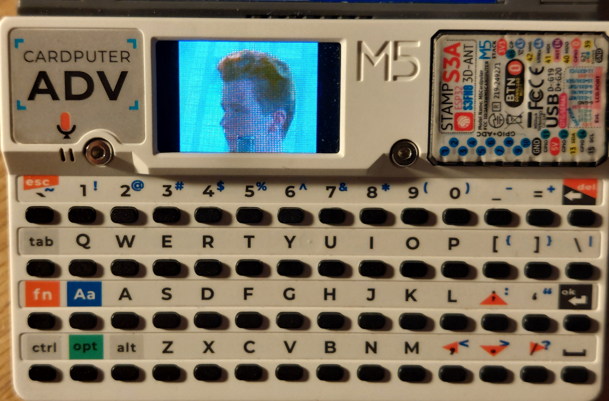
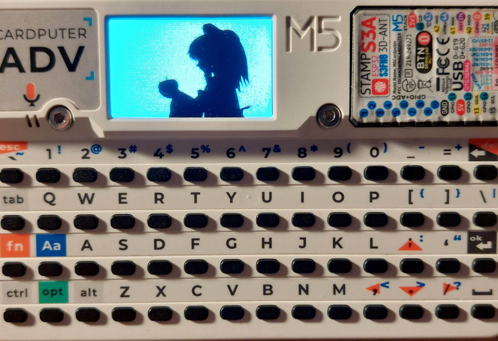

## Cardputer ADV H.264 video player
An experimental high-performance raw H.264 video player with PCM audio support designed for the limited resources (no PSRAM in particular) of the Cardputer ADV. 
## Pictures


## Preparing files
Video files need to be encoded with a specific ffmpeg command. Audio is converted separately. Make sure to use a good quality, fast SD card.\
**Video**
```
ffmpeg -i input.mp4 -c:v libx264 -profile:v baseline -tune fastdecode -preset veryslow\
-vf "format=yuv420p, scale=240:136, fps=30" -x264opts slices=1:ref=1 -an output.264
```
**Audio**
```
ffmpeg -i input.mp4 -vn -ac 1 -ar 22050 -c:a pcm_u8 -f u8 output.pcm
```

The filename and path of the audio track must match the one of the video to be detected.
## Features
Due to the significant resource constraints, particularly the lack of PSRAM I've implemented only the bare minimum and will probably not add more:
* Fixed 240x135 video/screen resolution.
* Basic file picker.
* Raw low-quality mono pcm audio synced to the video.  There is not enough memory for mp3/aac decoding.
* (Glitchy) Fast forward (press and hold f).
* Pause (press p).
* Volume adjustment (fn + up/down arrow).

## Performance
Most video files should reach 30fps as long as they can be read fast enough from the micro SD and they are encoded with the command above. Some may crash during playback if they their NALs don't fit in the buffer or the decoder tries to allocate too much heap memory. I don't think there is a way to completely resolve this as I've already implemented a lot of tricks to save as much ram as possible.

## License
GPLv3